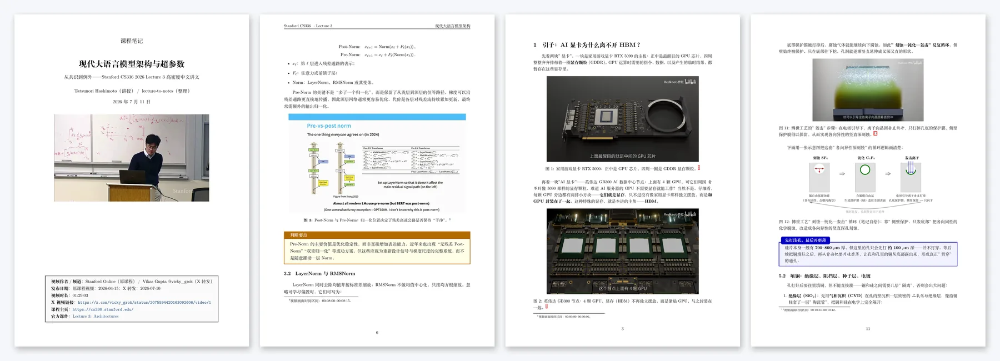
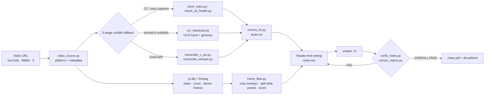
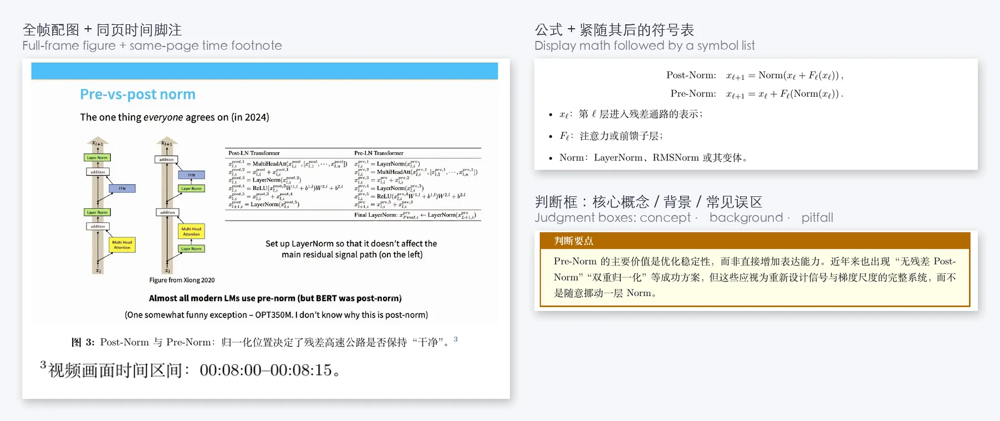
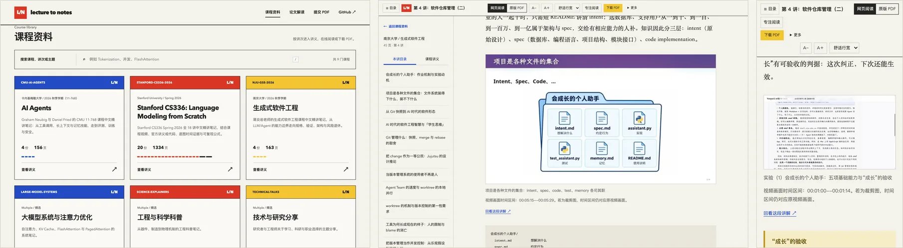

<div align="center">

# lecture-to-notes

**Turn a YouTube / Bilibili / X (Twitter) lecture video into a compilable Chinese LaTeX PDF and web article.**
Reader-first structure, every figure footnoted with its source timestamp range, every number traceable to the subtitles or slides.

[](https://github.com/ysyecust/lecture-to-notes/releases)
[](https://github.com/ysyecust/lecture-to-notes/actions/workflows/tests.yml)
[](https://github.com/ysyecust/lecture-to-notes/actions/workflows/pages.yml)
[](#dependencies)
[](LICENSE)

[**Browse the course library →**](https://blog.simona.plus/lecture-to-notes/) · [中文](README.md)



<sub>Left: cover and page 6 of Stanford CS336 Lecture 3 (“Modern LLM architectures and hyperparameters”); right: pages 3 and 11 of a Bilibili explainer on HBM memory.</sub>

</div>

## What it does

Give it a YouTube, Bilibili (including multi-part), or X/Twitter (`https://x.com/<user>/status/<id>[/video/<n>]`) URL and it produces a complete set of Chinese lecture notes: `notes.tex`, compiled `notes.pdf`, cropped figures, a cleaned subtitle track, and verification artifacts (figure manifest, numerical-claim ledger, and delivery-gate report).

The repository provides:
- **Agent skills**: [`lecture-to-notes`](skills/lecture-to-notes/SKILL.md) and [`paper-to-html`](skills/paper-to-html/SKILL.md) for Claude Code, Codex, and DeepSeek Harness
- **Course library site**: [blog.simona.plus/lecture-to-notes](https://blog.simona.plus/lecture-to-notes/), supporting both reflowable web articles and original PDFs



- **Five-stage subtitle fallback**: manual CC → platform auto captions (YouTube dedup via `clean_subs.py`; X/Twitter structural check via `check_srt_health.py` plus semantic spot-checks at 10%, 50%, and 90% of runtime) → burned-in subtitle OCR (`ocr_hardsubs.py`) → local ASR (`transcribe_x_asr.py` for zh/en, `transcribe_whisper.py` choosing `mlx-whisper` / `faster-whisper` / `openai-whisper`) → dictionary and multimodal correction (`correct_srt.py`, `llm_correct_srt.py`).
- **Frame filtering & three-way check**: `frame_filter.py` measures and crops static navigation strips and subtitle bands, splits camera-plus-slides composite recordings to keep the slide panel readable, and scores frames to reject talking-head shots; `verify_figures.py` verifies each figure against its timestamp and subtitle context.

## What the output looks like



- **Rebuilt teaching flow**: follows [`references/reader-first-writing.md`](skills/lecture-to-notes/references/reader-first-writing.md) — organized around reader questions rather than transcript order, explaining meaning before jargon.
- **Time-traceable figures**: every figure caption carries its source video interval (e.g. `00:08:00–00:08:15`), guaranteed by `verify_notes.py` to stay on the same page as the figure.
- **Formulas with symbol lists, numbers with sources**: display equations are followed by symbol definitions; every number with a unit is extracted and checked in `numerical_claims.tsv` via `extract_claims.py`.
- **Three judgment boxes**: core concept, background & trade-offs, and common pitfalls — used only when a takeaway benefits from standing apart from body prose.

## Quick start

### 1. Install the skill

```bash
scripts/install_skill.sh            # → ~/.agents/skills (DeepSeek Harness and Codex)
scripts/install_skill.sh --claude   # → ~/.claude/skills
scripts/install_skill.sh --codex    # → ~/.codex/skills
scripts/install_skill.sh --all      # all three
```

Trigger in Claude Code or Codex with `/lecture-to-notes <URL>`, or paste a YouTube / Bilibili / X link directly.

### 2. Output artifacts

| File | Content |
|---|---|
| `notes.tex` / `notes.pdf` | Complete LaTeX source and two-pass `xelatex` PDF |
| `figures/` · `figure_manifest.tsv` · `figure_verification.txt` | Cropped figures, source intervals, and three-way verification output |
| `audio.srt` (plus `audio_corrected.srt`, `hardsub_ocr.srt`) | Final subtitle track and correction history |
| `bands.json` · `layout.json` · `frame_scores.json` | Overlay geometry, composite panel layout, and frame scores |
| `lecture_profile.json` · `teaching_atoms.tsv` · `numerical_claims.tsv` | Reader profile, teaching-atom coverage, and numerical-claim ledger |
| `verify_notes.txt` | Delivery-gate report ending in `OVERALL PASS` |

## Course library and online reading

The [course site](https://blog.simona.plus/lecture-to-notes/) hosts Chinese lecture notes and paper analyses across multiple open courses (including Stanford CS336, CMU 15-418/618 *Parallel Computer Architecture and Programming*, CMU 11-768 *AI Agents*, and Nanjing University *Generative Software Engineering* and *Operating Systems* — currently 9 courses and collections, 101 lectures, and 2,451 lecture pages).



- **Web article & original PDF**: Lectures verified by `scripts/web_notes.py` open as reflowable web articles (16–28 px font size, comfortable/wide measure, click-to-zoom figures, and timestamp links back to the source video) with a one-click toggle to the original PDF running on a bundled PDF.js viewer (searchable Chinese text layer, outline, and 25%–800% zoom).
- **Reading progress & mobile layout**: Reading position is saved locally in `localStorage`; narrow screens fold the outline into a drawer. Conversion rules are documented in [docs/development/web-reading.md](docs/development/web-reading.md) (Chinese).
- **Contributing PDFs**: External contributors can submit course PDFs to `content/inbox/` via Fork and Pull Request; see [CONTRIBUTING.md](CONTRIBUTING.md) (Chinese).

## Dependencies

### macOS

```bash
brew install yt-dlp ffmpeg imagemagick poppler
brew install --cask mactex                      # xelatex + CTeX
pip install rapidocr-onnxruntime Pillow numpy   # burned-in subtitle OCR + frame_filter.py
pip install mlx-whisper                         # Apple Silicon GPU Whisper (use faster-whisper on Intel)
pip install sherpa-onnx                         # optional: fast zh/en X ASR
```

### Windows (winget)

```powershell
pip install --user yt-dlp faster-whisper rapidocr-onnxruntime Pillow numpy sherpa-onnx
winget install --id Gyan.FFmpeg -e --silent
winget install --id ImageMagick.ImageMagick -e --silent
winget install --id MiKTeX.MiKTeX -e --silent   # pass -enable-installer to xelatex for missing packages
```

### Linux (Debian / Ubuntu)

```bash
sudo apt install yt-dlp ffmpeg imagemagick poppler-utils texlive-xetex texlive-lang-chinese
pip install faster-whisper rapidocr-onnxruntime Pillow numpy sherpa-onnx
```

### Site build & tests (only needed to maintain the library)

```bash
brew install pandoc node          # Ubuntu/Debian: sudo apt install pandoc nodejs npm
pip install beautifulsoup4
npm ci
python3 -m scripts.build_site --root . --output _site --generated-at "$(date -u +%Y-%m-%dT%H:%M:%SZ)"
npm run test:e2e                  # Playwright desktop and mobile reading tests
PYTHONPATH=. python3 -m unittest discover -s tests -v
```

### 3. Clean up workspace artifacts (optional)

After generating notes, `scripts/clean_artifacts.py` removes intermediate frames, subtitle tracks, and logs by whitelist while keeping deliverables (`*.pdf`, `*.md`, referenced images, plus `notes.tex` and `figures/` by default):

```bash
python3 scripts/clean_artifacts.py                        # scan content/courses (report only)
python3 scripts/clean_artifacts.py <workdir> --dry-run    # preview cleanup list for <workdir>
python3 scripts/clean_artifacts.py <workdir>              # clean <workdir>
python3 scripts/clean_artifacts.py <workdir> --only-md    # keep only *.md and assets/
python3 scripts/clean_artifacts.py <workdir> --drop-tex   # also remove notes.tex and figures/
```

Release workflow details are in [docs/releasing.md](docs/releasing.md) (Chinese).

## Repository layout

<details>
<summary>Expand directory tree</summary>

```text
.
├── content/
│   ├── courses/                # course manifests (course.json), published PDFs, archived TeX sources
│   ├── inbox/                  # community PDF contribution inbox
│   └── papers.json             # paper-notes catalog
├── docs/                       # static course library front-end (index / reader / papers / contribute)
│   ├── assets/                 # framework-free front-end modules and styles
│   ├── development/            # dual-format conversion and publishing contract
│   └── papers/                 # published paper notes (HTML)
├── scripts/
│   ├── video_source.py         # YouTube / Bilibili / X URL detection and metadata probe
│   ├── check_srt_health.py     # subtitle coverage, duplication, and runtime-window checks
│   ├── clean_subs.py           # YouTube auto-caption deduplication
│   ├── ocr_hardsubs.py         # burned-in subtitle detection, OCR extraction, overlay geometry, glossary
│   ├── transcribe_x_asr.py     # sherpa-onnx X ASR local zh/en transcription
│   ├── transcribe_whisper.py   # Whisper backend selector (mlx / faster / openai) with progress budget
│   ├── correct_srt.py          # dictionary-based SRT batch correction
│   ├── llm_correct_srt.py      # multimodal segment-level SRT correction
│   ├── frame_filter.py         # overlay crops, camera-plus-slides panel splits, talking-head scores
│   ├── verify_figures.py       # three-way figure check (timestamp × subtitle × frame)
│   ├── extract_claims.py       # numerical-claim extraction and verification
│   ├── verify_notes.py         # one-shot delivery gate (density, artifacts, compile log, footnotes)
│   ├── clean_artifacts.py      # whitelist-based workspace artifact cleanup
│   ├── web_notes.py            # notes.tex → checked web article conversion
│   ├── build_site.py           # static site builder (with site_catalog.py and pdf_inspector.py)
│   └── install_skill.sh        # installs skill into local agent directories
├── skills/
│   ├── lecture-to-notes/       # main video → LaTeX/PDF lecture-notes skill
│   ├── lecture-to-md/          # video → Markdown sub-workflow
│   └── paper-to-html/          # paper → standalone HTML analysis skill
├── tests/                      # Python unittest suite
└── e2e/                        # Playwright browser test suite
```

</details>

## Acknowledgements & License

- Inspired by [Stefan0219/llm-note-generator](https://github.com/Stefan0219/llm-note-generator) and [wdkns/wdkns-skills](https://github.com/wdkns/wdkns-skills).
- Licensed under [GPL-3.0](LICENSE).
