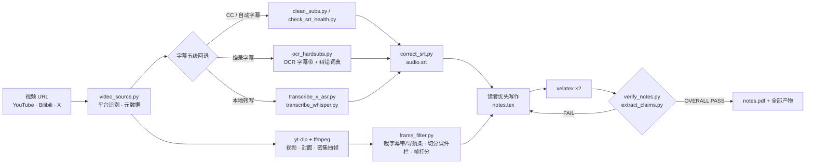

<div align="center">

# lecture-to-notes

**把 YouTube / Bilibili / X(Twitter) 的讲座视频，变成可编译的中文 LaTeX 讲义 PDF 与在线网页。**
按读者问题重构章节，每张配图带原视频时间脚注，每个数值可追溯到字幕或画面。

[](https://github.com/ysyecust/lecture-to-notes/releases)
[](https://github.com/ysyecust/lecture-to-notes/actions/workflows/tests.yml)
[](https://github.com/ysyecust/lecture-to-notes/actions/workflows/pages.yml)
[](#依赖安装)
[](LICENSE)

[**在线课程库 →**](https://blog.simona.plus/lecture-to-notes/) · [English](README.en.md)


<sub>左：Stanford CS336 Lecture 3《现代大语言模型架构与超参数》封面与第 6 页；右：B 站《HBM 高带宽内存的原理与制造》第 3、11 页。</sub>

</div>

## 它做什么

输入一个 YouTube、Bilibili（含分 P）或 X/Twitter（`https://x.com/<user>/status/<id>[/video/<n>]`）视频链接，自动产出一套完整的中文讲义：`notes.tex`、编译好的 `notes.pdf`、裁剪好的配图、修正后的字幕轨，以及配图清单、数值核对表与交付门禁报告。

仓库同时包含：
- **Agent Skill**：适用于 Claude Code / Codex / DeepSeek Harness 的 [`lecture-to-notes`](skills/lecture-to-notes/SKILL.md) 与论文解读 [`paper-to-html`](skills/paper-to-html/SKILL.md)
- **在线课程库**：[blog.simona.plus/lecture-to-notes](https://blog.simona.plus/lecture-to-notes/)，支持网页正文与原版 PDF 双模式阅读



- **字幕五级回退**：人工 CC → 平台自动字幕（YouTube 用 `clean_subs.py` 去重；X/Twitter 经 `check_srt_health.py` 结构检查并在 10%、50%、90% 三处抽样核对）→ 烧录字幕 OCR（`ocr_hardsubs.py`）→ 本地 ASR（中英混合优先 `transcribe_x_asr.py`，其余按平台自动选 `mlx-whisper` / `faster-whisper` / `openai-whisper`）→ 词典与多模态修正（`correct_srt.py`、`llm_correct_srt.py`）。
- **画面裁剪与三方校验**：`frame_filter.py` 自动测量并裁掉静态导航条和字幕带；遇到“讲者摄像头 + 课件”拼接画面时，只保留课件分栏，避免课件字迹缩成半页宽；每张配图入文前由 `verify_figures.py` 核对时间戳、字幕与画面一致。

## 成品特点


- **读者优先写作**：遵循 [`references/reader-first-writing.md`](skills/lecture-to-notes/references/reader-first-writing.md) 规范，按读者问题组织章节，先讲含义再给术语，不照搬口语流水账。
- **配图时间溯源**：每张图下方附原视频时间区间脚注（如 `00:08:00–00:08:15`），由 `verify_notes.py` 强制保证图与脚注同页。
- **公式有符号表，数字有出处**：独立公式后紧跟符号说明；讲座中出现的带单位数值由 `extract_claims.py` 记入 `numerical_claims.tsv` 逐条核对。
- **克制的判断框**：提供「核心概念 / 背景与权衡 / 常见误区」三类提示框，仅在需要从正文独立突出时使用。

## 快速开始

### 1. 安装 Skill

```bash
scripts/install_skill.sh            # → ~/.agents/skills（DeepSeek Harness 与 Codex 读取此目录）
scripts/install_skill.sh --claude   # → ~/.claude/skills
scripts/install_skill.sh --codex    # → ~/.codex/skills
scripts/install_skill.sh --all      # 以上三处同时安装
```

安装后在 Claude Code / Codex 中输入 `/lecture-to-notes <URL>`，或直接发送 YouTube / Bilibili / X 视频链接即可触发。

### 2. 运行产物

| 文件 | 说明 |
|---|---|
| `notes.tex` / `notes.pdf` | 完整 LaTeX 源码与两遍 `xelatex` 编译生成的 PDF |
| `figures/` · `figure_manifest.tsv` · `figure_verification.txt` | 裁剪后的配图、时间区间清单与三方校验记录 |
| `audio.srt`（及 `audio_corrected.srt`、`hardsub_ocr.srt`） | 最终使用的字幕轨与修正记录 |
| `bands.json` · `layout.json` · `frame_scores.json` | 叠加层几何、课件分栏位置与候选帧评分 |
| `lecture_profile.json` · `teaching_atoms.tsv` · `numerical_claims.tsv` | 读者定位、教学原子覆盖表与数值主张核对表 |
| `verify_notes.txt` | 交付门禁报告（末行为 `OVERALL PASS`） |

## 课程资料库与在线阅读

[在线课程库](https://blog.simona.plus/lecture-to-notes/)收录了多门公开课的中文讲义与论文解读（包括 Stanford CS336、CMU 15-418/618《并行计算机架构与编程》、CMU 11-768 AI Agents、南京大学《生成式软件工程》与《操作系统》等，当前共 9 门课程与专题、101 讲、2,451 页正课讲义）。


- **网页正文与原版 PDF 双模式**：通过 `scripts/web_notes.py` 校验的讲义默认打开可重排的网页正文（支持 16–28 px 字号、行宽切换、配图点击放大、点击时间区间跳回原视频对应时刻），工具栏可一键切回打包了本地 PDF.js 的原版 PDF 阅读器（支持中文全文检索、书签与 25%–800% 缩放）。
- **阅读进度记忆与移动端适配**：阅读位置保存在浏览器本地 `localStorage`；窄屏与手机端自动将目录收纳为抽屉。双格式转换与校验规则详见 [docs/development/web-reading.md](docs/development/web-reading.md)。
- **贡献讲义 PDF**：欢迎通过 Fork + Pull Request 将课程 PDF 提交至 `content/inbox/`，具体步骤与格式要求见 [CONTRIBUTING.md](CONTRIBUTING.md)。

## 依赖安装

### macOS

```bash
brew install yt-dlp ffmpeg imagemagick poppler
brew install --cask mactex                      # 含 xelatex + CTeX 中文支持
pip install rapidocr-onnxruntime Pillow numpy   # 烧录字幕 OCR + 画面裁剪
pip install mlx-whisper                         # Apple Silicon GPU 转写（Intel Mac 用 faster-whisper）
pip install sherpa-onnx                         # 可选：X ASR 中英混合快速本地转写
```

### Windows（winget）

```powershell
pip install --user yt-dlp faster-whisper rapidocr-onnxruntime Pillow numpy sherpa-onnx
winget install --id Gyan.FFmpeg -e --silent
winget install --id ImageMagick.ImageMagick -e --silent
winget install --id MiKTeX.MiKTeX -e --silent   # 命令行调用 xelatex 时可加 -enable-installer 自动装宏包
```

### Linux（Debian / Ubuntu）

```bash
sudo apt install yt-dlp ffmpeg imagemagick poppler-utils texlive-xetex texlive-lang-chinese
pip install faster-whisper rapidocr-onnxruntime Pillow numpy sherpa-onnx
```

### 静态站点构建与测试（仅维护课程库时需要）

```bash
brew install pandoc node          # Ubuntu/Debian: sudo apt install pandoc nodejs npm
pip install beautifulsoup4
npm ci
python3 -m scripts.build_site --root . --output _site --generated-at "$(date -u +%Y-%m-%dT%H:%M:%SZ)"
npm run test:e2e                  # Playwright 桌面与移动端阅读流程测试
PYTHONPATH=. python3 -m unittest discover -s tests -v
```

### 3. 清理工作目录（可选）

完成生成后，可使用 `scripts/clean_artifacts.py` 按白名单清理抽帧、字幕、日志等中间产物，仅保留成品（`*.pdf`、`*.md`、被引用的配图及默认保留的 `notes.tex` 与 `figures/`）：

```bash
python3 scripts/clean_artifacts.py                        # 扫描 content/courses，仅报告不删除
python3 scripts/clean_artifacts.py <workdir> --dry-run    # 查看指定工作目录的待清理清单
python3 scripts/clean_artifacts.py <workdir>              # 直接清理指定工作目录
python3 scripts/clean_artifacts.py <workdir> --only-md    # 仅保留 *.md 与 assets/
python3 scripts/clean_artifacts.py <workdir> --drop-tex   # 连同 notes.tex 与 figures/ 一并清理
```

版本发布流程见 [docs/releasing.md](docs/releasing.md)。

## 仓库结构

<details>
<summary>展开目录树</summary>

```text
.
├── content/
│   ├── courses/                # 各课程 manifest (course.json)、已发布 PDF 与归档 TeX 源码
│   ├── inbox/                  # 社区 PDF 投稿目录
│   └── papers.json             # 论文解读清单
├── docs/                       # 课程库静态站点前端（index / reader / papers / contribute）
│   ├── assets/                 # 无框架前端脚本与样式
│   ├── development/            # 双格式讲义转换与发布约定
│   └── papers/                 # 已发布的论文解读 HTML
├── scripts/
│   ├── video_source.py         # YouTube / Bilibili / X(Twitter) URL 识别与元数据探测
│   ├── check_srt_health.py     # 字幕覆盖率、重复率与时间跨度健康检查
│   ├── clean_subs.py           # YouTube 自动字幕去重
│   ├── ocr_hardsubs.py         # 烧录字幕检测、OCR 提取、叠加层几何与纠错词表生成
│   ├── transcribe_x_asr.py     # sherpa-onnx X ASR 中英混合本地转写
│   ├── transcribe_whisper.py   # Whisper 多后端自动选择（mlx / faster / openai）与超时控制
│   ├── correct_srt.py          # 基于词典的 SRT 批量修正
│   ├── llm_correct_srt.py      # 结合抽帧画面的多模态段落级 SRT 修正
│   ├── frame_filter.py         # 导航条/字幕带裁剪、摄像头+课件分栏切分、讲者帧打分
│   ├── verify_figures.py       # 配图时间戳 × 字幕 × 画面三方核对
│   ├── extract_claims.py       # 字幕/OCR 数值提取与讲义核对
│   ├── verify_notes.py         # 交付门禁（篇幅密度、产物完整性、编译日志、图注同页）
│   ├── clean_artifacts.py      # 工作目录中间产物白名单清理工具
│   ├── web_notes.py            # notes.tex → 网页正文转换与哈希/计数校验
│   ├── build_site.py           # 静态站点构建（配合 site_catalog.py 与 pdf_inspector.py）
│   └── install_skill.sh        # 安装 Skill 到本地 Agent 目录
├── skills/
│   ├── lecture-to-notes/       # 核心视频转 LaTeX/PDF 讲义 Skill
│   ├── lecture-to-md/          # 视频转 Markdown 笔记子工作流
│   └── paper-to-html/          # 论文转单文件 HTML 解读 Skill
├── tests/                      # Python 单元测试套件
└── e2e/                        # Playwright 端到端浏览器测试
```

</details>

## 致谢与许可

- 感谢 [Stefan0219/llm-note-generator](https://github.com/Stefan0219/llm-note-generator) 与 [wdkns/wdkns-skills](https://github.com/wdkns/wdkns-skills) 提供的早期思路启发。
- 本项目采用 [GPL-3.0](LICENSE) 许可证。
